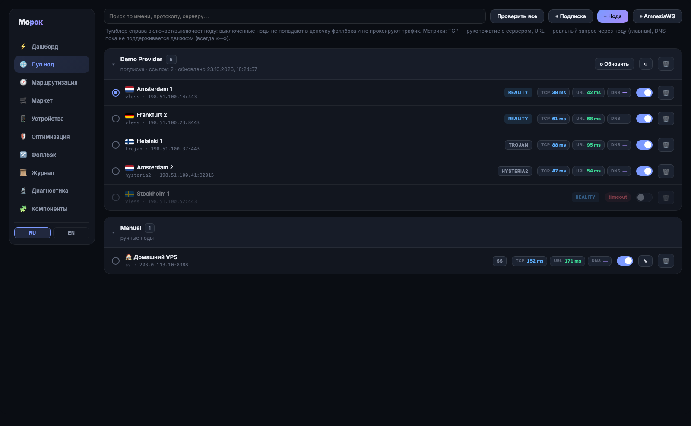
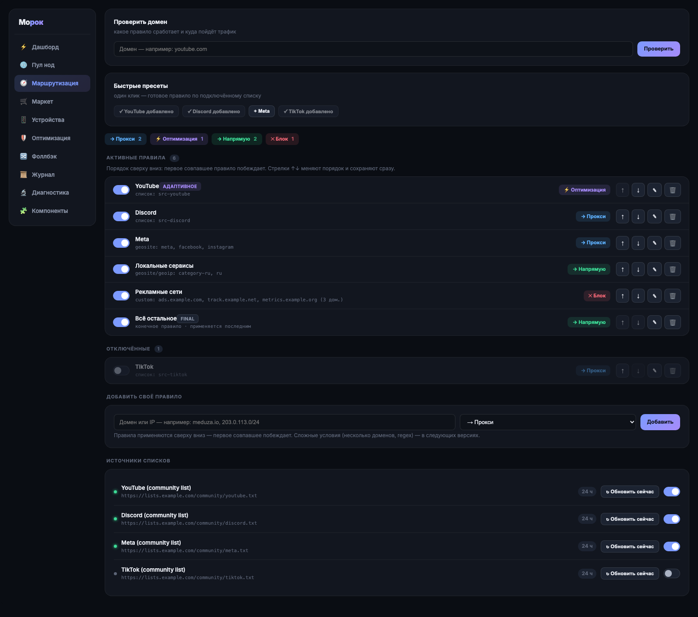
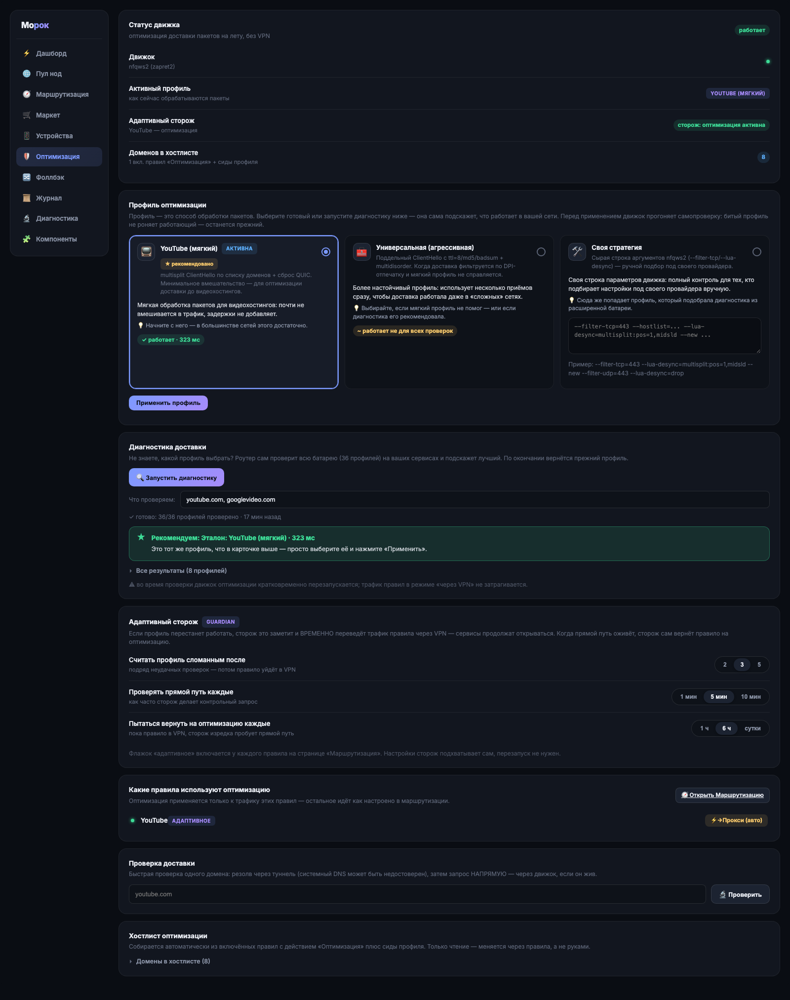

# Морок

**Морок** — LuCI-приложение для OpenWrt: продвинутая маршрутизация и
оптимизация трафика прямо на роутере. Правила по доменам и спискам,
цепочки прокси с автопереключением, менеджер подписок, метрики и
диагностика сети — для всех устройств в сети разом.

> Старослав. *морокъ* — «наваждение, обман зрения». Трафик под контролем,
а не на глазах у чужих систем фильтрации.

[](https://github.com/akurach/morok/releases)
[](LICENSE)

---

## Установка — одна команда

Подключись к роутеру по SSH и выполни:

```sh
curl -fsSL https://cdn.jsdelivr.net/gh/akurach/morok@main/build/install.sh | sh
```

Скрипт сам определит пакетный менеджер (opkg / apk), скачает свежий релиз,
проверит sha256, поставит зависимости и запустит сервис. Канал обновлений
раздаётся через jsdelivr — **манифесты доступны из сетей**, где
`raw.githubusercontent.com` недоступен.

Дальше — веб-интерфейс: **LuCI → Services → Морок** (после установки обнови
страницу через Ctrl+Shift+R).

Подробно по прошивкам: [GL.iNet Flint 2](docs/install-gl.md) ·
[ванильный OpenWrt](docs/install-vanilla.md)

## Что умеет

- **Прозрачная маршрутизация для всей сети** — tproxy на sing-box или xray
  (оба ядра вендорятся в пакете, переключение одной кнопкой). Ничего
  настраивать на устройствах не нужно.
- **Умные правила маршрутизации** — что в прокси-туннель, что напрямую, что
  на оптимизацию доставки: готовые списки доменов (YouTube, Discord, Meta,
  списки сообщества re:filter ~81k доменов, geosite/geoip), кастомные
  правила, пресеты.
- **Оптимизация доставки пакетов (zapret2/nfqws2)** — профили фрагментации
  и модификации пакетов для правил с действием «Оптимизация» (профиль
  «universal» для видеохостингов), адаптивные стратегии со сторожем
  guardian.
- **Fallback-цепочки нод** — активная нода перестала отвечать →
  автоматически переключаемся на следующую живую (urltest), с kill switch
  на выбор: перекрыть трафик / пустить напрямую / ничего не делать.
- **Per-device маршрутизация** — телевизор через прокси, рабочий ноут
  напрямую, консоль через конкретную ноду. По MAC, из списка DHCP-клиентов.
- **Подписки** — основная + резервная ссылки, автообновление по расписанию,
  HWID-заголовки для панелей (Happ и подобные), парсер vless/vmess/trojan/
  ss/hy2/tuic + AmneziaWG.
- **Метрики и прозрачность** — графики скорости туннеля, трафик по нодам и
  правилам, журнал решений (почему выбрана эта нода, что делает сторож),
  диагностика сети по этапам.
- **Самодостаточный пакет** — все критичные бинари (sing-box, xray, nfqws2)
  едут внутри ipk/apk; обновляются из нашего канала со страницы
  «Компоненты», когда мы сами решим, а не когда сломается апстрим.

## Совместимость

| Прошивка | Пакетный менеджер | Пакет | Статус |
|---|---|---|---|
| GL.iNet Flint 2 (GL-MT6000, прошивка 4.x) | opkg | `.ipk` | ✅ первичная платформа, боевая |
| Ванильный OpenWrt 24.10 | opkg | `.ipk` | ✅ проверено |
| Ванильный OpenWrt 23.05 | opkg | `.ipk` | ✅ формат и зависимости проверены |
| Ванильный OpenWrt 25.x | apk | `.apk` | ✅ проверено |

Архитектура сборки: `aarch64_cortex-a53` (MediaTek Filogic 830 и др.).
Требования: ~64 МБ свободной флеш-памяти (вендорные бинари), ≥ 256 МБ RAM
(рекомендуется 512). Подробности: [матрица совместимости](docs/install-vanilla.md#матрица-совместимости).

## Скриншоты


| Пул нод | Маршрутизация | Оптимизация |
|---|---|---|
|  |  |  |

*(на скриншотах — демонстрационные данные оффлайн-стенда, не реальные серверы;
как переснять: [docs/screenshots](docs/screenshots/README.md))*

## Как это работает

```
LuCI UI ──ubus──> rpcd backend ──> UCI (/etc/config/morok)
                        │
                        v
              gen_config.uc ──> sing-box.json (tmpfs)
                        │
        sing-box / xray (tproxy :7895, mixed :7890, Clash API :9090)
                        │
        nftables (tproxy + kill switch + per-device)
                        │
   подписки / rule-sets / guardian / оптимизация nfqws2 / обновления бинарей
```

Подробнее: [docs/architecture.md](docs/architecture.md). Состояние живёт в
tmpfs (флеш не жжём), в постоянной памяти — только настройки.

## Почему не PassWall / Home Proxy

Морок — замена PassWall 2 с нормальным UX: современный интерфейс вместо
простыни форм, профили оптимизации доставки пакетов из коробки (у passwall
их нет), fallback-цепочки и kill switch как первоклассные сущности,
вендорные бинари с собственным каналом обновлений, per-device маршрутизация,
живые метрики и журнал решений. Развёрнуто: [docs/faq.md](docs/faq.md).

## Обновление и удаление

```sh
# обновление — та же команда, что и установка (конфиг сохраняется)
curl -fsSL https://cdn.jsdelivr.net/gh/akurach/morok@main/build/install.sh | sh

# удаление (конфиг сохраняется)
opkg remove luci-app-morok        # OpenWrt ≤ 24.x
apk del luci-app-morok            # OpenWrt 25+
# полный снос с конфигом:
MOROK_PURGE=1 opkg remove luci-app-morok
```

## Статус проекта

Публичная бета (0.2.0). Готовы: ядро, UI, оптимизация доставки пакетов,
два движка, AmneziaWG, метрики, ipk+apk. В работе: самообновление
приложения, маркет списков правил. Телеметрии нет и не будет без
отдельного opt-in обсуждения.

## Дисклеймер

Морок — инструмент для управления собственным сетевым трафиком и
исследования сетей: маршрутизации, диагностики и оптимизации доставки
пакетов на собственном оборудовании. Пользователь обязан самостоятельно
соблюдать законы и правила своей юрисдикции и условия своего провайдера.
Авторы не несут ответственности за использование инструмента в нарушение
применимого законодательства.

## Лицензия

[GPL-3.0](LICENSE). Вендорные бинари сохраняют лицензии апстримов
(sing-box — MIT, Xray-core — MPL-2.0, zapret2 — см. репозиторий bol-van).

---

## English (short)

**Morok** is a LuCI app for OpenWrt: advanced traffic routing and
optimization at the router level — transparent proxying (sing-box or xray,
both vendored), smart routing rules by domains and community lists, packet
delivery optimization profiles (zapret2/nfqws2), fallback node chains with
kill switch, per-device routing, subscriptions with scheduled updates, live
metrics and network diagnostics. The update channel is served via jsdelivr
so manifests stay reachable where GitHub raw content is not.

Install on OpenWrt 23.05/24.10/25.x or GL.iNet Flint 2:

```sh
curl -fsSL https://cdn.jsdelivr.net/gh/akurach/morok@main/build/install.sh | sh
```

The UI speaks Russian and English (RU/EN switcher in the sidebar):


Disclaimer: Morok is a tool for managing your own network traffic and for
network research. You are responsible for complying with the laws of your
jurisdiction. Docs are in Russian: [docs/](docs/). License: GPL-3.0.
